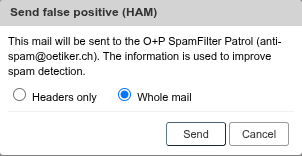

# zimlet-spamham

"Send SPAM|HAM" for the Zimbra web clients (tested on Zimbra 10.1.21): a
toolbar button in the Classic client and an item in the "More" menu of the
Modern client.

A click opens a dialog that names the recipient and offers "Headers only"
or "Whole mail" (default). Every selected mail is then sent to a
configured anti-spam address, one report per mail:

- Mail in Junk is reported as HAM (false positive). A copy with the spam
  markers removed is stored in the Inbox and the original goes to Trash.
  A mail without markers is moved to the Inbox as it is.
- Mail in any other own folder is reported as SPAM and moved to Junk.
- Sent mail, drafts and mail in shared folders are skipped. Of a selected
  conversation, only the open message (else the newest one outside Trash,
  Sent and Drafts) is reported.

The report has the subject `[SPAM Report Full] <server> <account>`;
`SPAM` or `HAM` by direction, `Full` or `Header` by the content chosen in the
dialog. It carries the headers `X-ZSR-Type`, `X-ZSR-Domain` and
`X-ZSR-Server`, and a body in the format of Zimbra's own spam training
report (`Classified-As: spam|ham`, `Report-Content: full|headers`). The
reported mail is attached as `message/rfc822`; with "Headers only" it keeps
its original headers and its content is replaced by one line of text.

Texts are in English and German, chosen by the language of the web client.

The two clients need two zimlets:

| Client | Zimlet | Package |
|---|---|---|
| Classic | `ch_oetiker_report_spam_ham_classic` | `ch_oetiker_report_spam_ham_classic.zip` |
| Modern | `ch_oetiker_report_spam_ham_modern` | `ch_oetiker_report_spam_ham_modern.zip` |

## Install

Download both packages from the
[latest release](https://github.com/oposs/zimlet-spamham/releases/latest),
or build them yourself.

## Build

Node 24 and pnpm 11 for the Modern zimlet (`modern/mise.toml` pins them for
[mise](https://mise.jdx.dev/)); the packages land in `dist/`:

    make test classic modern

[docs/maintainer-notes.md](docs/maintainer-notes.md) explains the build of
the Modern zimlet and why the Classic files stay ES3.

## Prerequisites on the server

Allow the report headers once per server, otherwise `SendMsgRequest`
fails with `header 'X-ZSR-Type' not allowed`:

    zmprov mcf +zimbraCustomMimeHeaderNameAllowed X-ZSR-Type \
               +zimbraCustomMimeHeaderNameAllowed X-ZSR-Domain \
               +zimbraCustomMimeHeaderNameAllowed X-ZSR-Server
    zmprov fc config

To make this button the only way to report, leave Zimbra's own training
addresses empty; otherwise its Junk / Not Junk actions forward mail too:

    zmprov gcf zimbraSpamIsSpamAccount zimbraSpamIsNotSpamAccount

The HAM copy goes through `/service/upload`, which is limited by
`zimbraFileUploadMaxSize`. When the upload is refused, the original is
moved to the Inbox unchanged and the status message says so.

## Deploy

`zmzimletctl deploy` also enables the zimlet in COS `default`. Remove it
there and enable it in the COS that should have it:

    zmzimletctl deploy <zimlet>.zip
    zmprov mc default -zimbraZimletAvailableZimlets +<zimlet>
    zmprov mc <cos> +zimbraZimletAvailableZimlets +<zimlet>
    zmprov fc cos; zmprov fc zimlet

A `zimbraZimletAvailableZimlets` value on an account replaces the whole COS
list, so enable zimlets per COS, not per account. Users reload the web
client (Ctrl+Shift+R) to see the change.

## Configure

The zimlets ship without a report address; set `reportAddress` (or
`reportByDomain`) before use. The configuration is stored per zimlet name;
configure both zimlets with the same values:

    zmzimletctl getConfigTemplate <zimlet>.zip > config_template.xml
    # edit config_template.xml
    zmzimletctl configure config_template.xml
    zmprov fc zimlet

| Property | Default | Meaning |
|---|---|---|
| `reportAddress` | empty, must be configured | Recipient of the reports |
| `reportTeam` | empty | Recipient name shown in the dialog; when empty, the dialog names only the address |
| `reportByDomain` | empty | Recipient per mail domain, see below |
| `serverName` | empty (host name of the web client) | Server name written into the report |
| `hamStripHeaders` | `X-Spam-Flag,X-Spam-Status,…` | Headers removed from the HAM copy |
| `hamStripSubject` | three SPAM subject patterns | Regexes, one per line, removed from the subject of the HAM copy |

`reportByDomain` holds one line per mail domain:
`<domain> <address> [team name]`. An account of a listed domain reports to
that address and sees that team name (`reportTeam` when the line has none);
all other accounts use `reportAddress` and `reportTeam`:

    <property name="reportByDomain">example.org abuse@example.org Example Abuse Desk
    example.com spam@example.com</property>

An invalid `reportByDomain` line or `hamStripSubject` pattern, or an
account without a report address, aborts the click with an error message;
nothing is sent.

`zmzimletctl deploy` replaces a stored configuration only when the version
in `config_template.xml` is higher than the stored one. That version is
raised only when the shipped properties change (`test/template.test.js`);
after such an upgrade configure the values again.

## Remove

    zmzimletctl undeploy ch_oetiker_report_spam_ham_classic
    zmzimletctl undeploy ch_oetiker_report_spam_ham_modern

## License

MIT, see [LICENSE](LICENSE).
